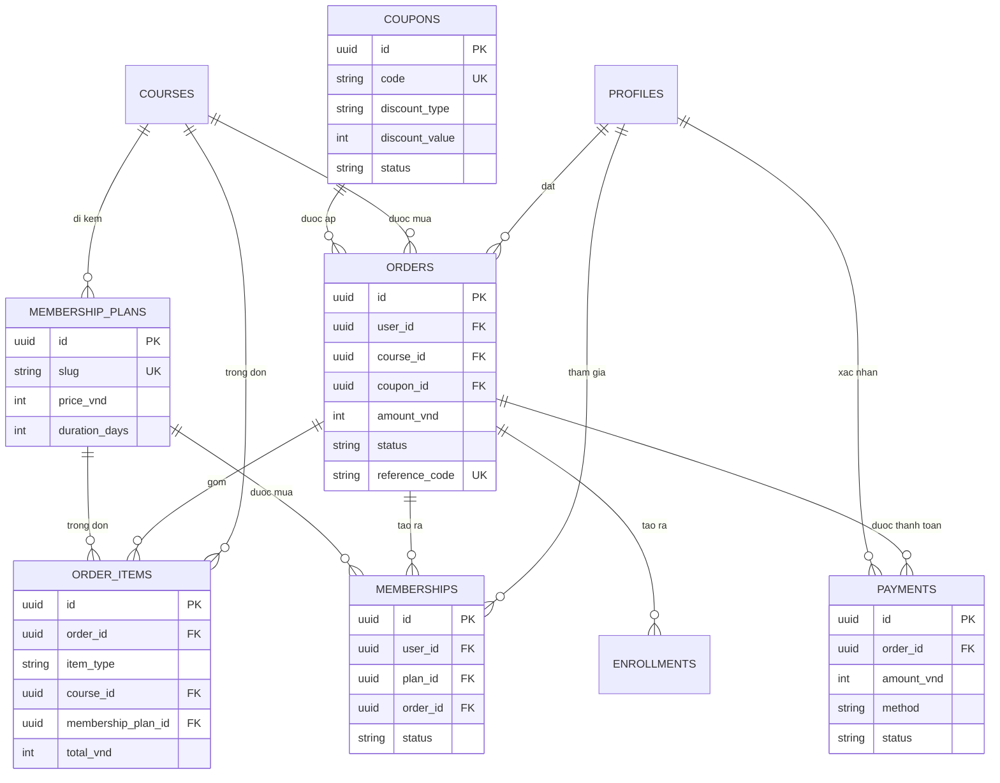
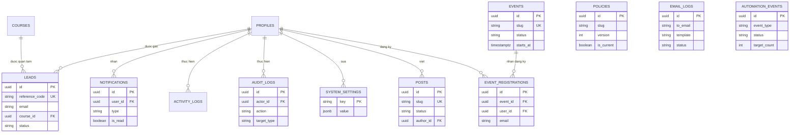

# DATABASE_ERD.md — Sơ đồ quan hệ thực thể Visfar Academy (Task 03)

**Ngày:** 10/11/2026
**Trạng thái:** Chờ phê duyệt
**Phạm vi:** Thiết kế (design-only). **Không triển khai DB, không chạy migration, không sửa code.**
**Tài liệu đi kèm:** `DATABASE_SCHEMA.md` (cùng thư mục — đặc tả cột/kiểu/ràng buộc/index của từng bảng). Mọi tên bảng, khóa ngoại và quy tắc ON DELETE trong file này phải khớp với `DATABASE_SCHEMA.md`; nếu lệch, lấy `DATABASE_SCHEMA.md` làm chuẩn và ghi chú ở §7.

**Nguồn:** Tài liệu kiến trúc tổng thể (§3–§4), `docs/DECISIONS.md`, `docs/architecture/SYSTEM_ARCHITECTURE.md` (§5), `docs/architecture/ROLE_PERMISSION_MATRIX.md` (§5), `supabase/migrations/0001_init_schema.sql` (Module 1).

**Quy ước ký hiệu:** `1—1` một–một · `1—N` một–nhiều · `N—N` nhiều–nhiều (qua bảng liên kết) · `o` phía “không” (nullable) · `FK` khóa ngoại. Tiền lưu `integer` (VND). Mũi tên đọc từ trái sang phải: “1 khóa học có N module”.

---

## 1. ERD tổng thể (Mermaid) — chia 3 sơ đồ theo phân hệ

### 1.1. Phân hệ học tập (LMS + Assessment)

```mermaid
erDiagram
    PROFILES ||--o{ USER_ROLES : "duoc cap"
    PROFILES ||--o{ ENROLLMENTS : "ghi danh"
    PROFILES ||--o{ LESSON_PROGRESS : "hoc"
    PROFILES ||--o{ QUIZ_ATTEMPTS : "lam quiz"
    PROFILES ||--o{ SUBMISSIONS : "nop bai"
    PROFILES ||--o{ CERTIFICATES : "nhan"
    PROFILES ||--o{ COURSE_INSTRUCTORS : "phu trach"
    CATEGORIES ||--o{ COURSES : "nhom"
    COURSES ||--o{ COURSE_MODULES : "gom"
    COURSES ||--o{ ENROLLMENTS : "duoc dang ky"
    COURSES ||--o{ COURSE_INSTRUCTORS : "duoc phu trach"
    COURSE_MODULES ||--o{ LESSONS : "gom"
    LESSONS ||--o{ LESSON_RESOURCES : "dinh kem"
    LESSONS ||--o{ QUIZZES : "chua"
    LESSONS ||--o{ ASSIGNMENTS : "chua"
    LESSONS ||--o{ LESSON_PROGRESS : "duoc hoc"
    LESSONS ||--o{ QUIZ_ATTEMPTS : "duoc lam"
    QUIZZES ||--o{ QUESTIONS : "gom"
    QUESTIONS ||--o{ QUESTION_OPTIONS : "co lua chon"
    QUIZ_ATTEMPTS ||--o{ ANSWERS : "gom dap an"
    QUESTIONS ||--o{ ANSWERS : "duoc tra loi"
    QUESTION_OPTIONS ||--o{ ANSWERS : "duoc chon"
    ASSIGNMENTS ||--o{ SUBMISSIONS : "nhan bai nop"
    SUBMISSIONS ||--o{ SUBMISSION_REVIEWS : "duoc cham"
    ENROLLMENTS ||--o{ CERTIFICATES : "dan den"
    COURSES ||--o{ CERTIFICATES : "cap cho"
    PROFILES ||--o{ LEARNING_EVENTS : "phat sinh"
    COURSES ||--o{ LEARNING_EVENTS : "lien quan"
    LESSONS ||--o{ LEARNING_EVENTS : "lien quan"

    PROFILES {
        uuid id PK
        string email UK
        string role
        string status
    }
    COURSES {
        uuid id PK
        string slug UK
        uuid category_id FK
        int price_vnd
        string status
    }
    COURSE_MODULES {
        uuid id PK
        uuid course_id FK
        int display_order
    }
    LESSONS {
        uuid id PK
        uuid module_id FK
        string slug
        string type
    }
    QUIZZES {
        uuid id PK
        uuid lesson_id FK_UK
        int passing_score_percent
    }
    QUESTIONS {
        uuid id PK
        uuid quiz_id FK
        string question_type
    }
    QUESTION_OPTIONS {
        uuid id PK
        uuid question_id FK
        boolean is_correct
    }
    QUIZ_ATTEMPTS {
        uuid id PK
        uuid user_id FK
        uuid lesson_id FK
        int score
        int total
    }
    ANSWERS {
        uuid id PK
        uuid quiz_attempt_id FK
        uuid question_id FK
        uuid selected_option_id FK
    }
    ASSIGNMENTS {
        uuid id PK
        uuid lesson_id FK_UK
        string assignment_type
    }
    SUBMISSIONS {
        uuid id PK
        uuid assignment_id FK
        uuid user_id FK
        string status
    }
    ENROLLMENTS {
        uuid id PK
        uuid user_id FK
        uuid course_id FK
        uuid order_id FK
        string status
    }
```

**Đọc sơ đồ 1.1:**

- Một khóa học (`courses`) có nhiều module (`course_modules`); một module có nhiều bài học (`lessons`); một bài học có nhiều tài liệu (`lesson_resources`).
- Một bài học loại `quiz` có đúng 1 quiz (`quizzes`, UNIQUE `lesson_id`); một quiz có nhiều câu hỏi (`questions`); một câu hỏi có nhiều lựa chọn (`question_options`, trong đó `is_correct` là đáp án đúng — xem cảnh báo §1.4).
- Một lượt làm quiz (`quiz_attempts`) có nhiều dòng đáp án (`answers`); mỗi dòng `answers` trỏ tới 1 câu hỏi và 1 lựa chọn đã chọn (hoặc `answer_text`).
- Một bài học loại `assignment` có đúng 1 bài tập (`assignments`, UNIQUE `lesson_id`); một bài tập nhận nhiều bài nộp (`submissions`); một bài nộp có 1 kết quả chấm (`submission_reviews`, UNIQUE `submission_id`).
- `enrollments` là bảng liên kết N—N giữa `profiles` và `courses` (UNIQUE `user_id, course_id`); hoàn thành khóa → sinh `certificates` (UNIQUE `user_id, course_id`).
- `course_instructors` là bảng liên kết N—N giữa `profiles` (role `instructor`) và `courses`.
- `learning_events` là bảng log append-only, tham chiếu mềm tới user/khóa/bài (không phải bảng nghiệp vụ chính).

### 1.2. Phân hệ thương mại (Orders + Memberships + Coupons)



**Đọc sơ đồ 1.2:**

- Một đơn hàng (`orders`) có nhiều dòng hàng (`order_items`); mỗi dòng là 1 khóa học **hoặc** 1 gói thành viên (`item_type` phân biệt, CHECK bắt buộc chỉ 1 trong 2 FK có giá trị).
- `orders.course_id` được **giữ lại** từ Module 1 (đơn 1 khóa) để tương thích; dòng hàng chi tiết nằm ở `order_items`. Giai đoạn đầu 2 nơi này là 1–1; đơn nhiều khóa là mở rộng tương lai (quyết ở §7, Q10).
- Một đơn có nhiều lần thanh toán (`payments`); đơn `paid` sinh `enrollments` (khóa học) và/hoặc `memberships` (gói thành viên).
- `coupons` áp cho đơn qua `orders.coupon_id` (SET NULL khi xóa coupon — coupon đã dùng vẫn giữ `discount_vnd` snapshot ở đơn).
- `membership_plans` có thể đi kèm 1 khóa (`course_id` nullable); mua gói → tạo `memberships`, và (nếu gói có khóa đi kèm) tạo `enrollments` — quyết ở §7, Q11.

### 1.3. Phân hệ CRM / vận hành (Leads + Events + Content + Logs)



**Đọc sơ đồ 1.3:**

- `leads` tham chiếu tới `courses` (nullable — “Chưa biết bắt đầu từ đâu”) và tới `profiles` qua `user_id` (liên kết khi lead đăng ký tài khoản bằng cùng email) / `assigned_to` (admin phụ trách).
- `email_logs`, `automation_events`, `policies`, `newsletter_subscribers` (không vẽ trong Mermaid để sơ đồ gọn) **không có FK cứng** tới bảng nghiệp vụ — liên kết mềm qua `related_type` + `related_id` (email/automation) hoặc độc lập hoàn toàn (policies, newsletter). Nhờ vậy xóa/archive đối tượng nghiệp vụ không bị khóa bởi log.
- `notifications` gắn với 1 user; `audit_logs` / `activity_logs` gắn với người thực hiện; `system_settings` là key–value độc lập.
- `events` → `event_registrations` (1–N, UNIQUE `event_id, email`); `posts.author_id` → `profiles` (SET NULL khi xóa tác giả).

### 1.4. ⚠️ Cảnh báo: hai cặp tên dễ nhầm nhất trong ERD

| Cặp tên | Khác nhau ở đâu | Hậu quả nếu nhầm |
|---|---|---|
| `answers` vs `question_options` | `answers` = đáp án **học viên chọn** (theo lượt làm bài); `question_options` = lựa chọn của câu hỏi, chứa `is_correct` = **đáp án đúng** | Trả `is_correct` về client → lộ đề, gian lận điểm; chấm điểm bằng `answers` thay vì đối chiếu `question_options` → sai kết quả |
| `learning_events` vs `events` | `learning_events` = nhật ký **hành vi học tập** (xem bài, nộp quiz…); `events` = **sự kiện lịch** (workshop/Q&A) | Gộp 2 bảng → mất lịch sự kiện + đăng ký sự kiện, hoặc làm phình bảng log bằng dữ liệu lịch |

---

## 2. ERD dạng ASCII (toàn cảnh — 38 bảng)

```
auth.users ──1──1── profiles ──1──N── user_roles (lich su cap role)
                  │
                  ├──1──N── enrollments ──N──1── courses ──1──N── course_modules
                  │             │   (UNIQUE user+course)      │         │
                  │             │                             │         └──1──N── lessons
                  │             │                             │                   │
                  │             │                             │                   ├──1──N── lesson_resources
                  │             │                             │                   ├──1──1── quizzes ──1──N── questions
                  │             │                             │                   │                          │
                  │             │                             │                   │                          └──1──N── question_options (is_correct)
                  │             │                             │                   │
                  │             │                             │                   └──1──1── assignments ──1──N── submissions
                  │             │                             │                                                    │
                  │             │                             │                                                    └──1──1── submission_reviews
                  │             │                             │
                  │             ├──N──1── orders ──1──N── order_items ──N──1── courses / membership_plans
                  │             │             │──1──N── payments
                  │             │             └──(coupon_id)──N──1── coupons
                  │             │
                  │             └──1──1── certificates (UNIQUE user+course)
                  │
                  ├──1──N── lesson_progress (UNIQUE user+lesson)
                  ├──1──N── quiz_attempts ──1──N── answers ──N──1── questions / question_options
                  ├──1──N── memberships ──N──1── membership_plans
                  ├──1──N── learning_events (log hoc tap)
                  ├──1──N── activity_logs (log hanh vi)
                  ├──1──N── notifications
                  ├──1──N── event_registrations ──N──1── events
                  └──1──N── audit_logs (actor) / posts (author) / leads (assigned/user)
                                    │
courses ──1──N── leads (course_id NULL duoc)
courses ──1──N── course_instructors ──N──1── profiles (instructor)
courses ──1──N── membership_plans (course_id NULL duoc)
courses ──1──N── orders (RESTRICT khi xoa khoa)

--- Khong co FK cung (lien ket mem / doc lap) ---
email_logs (related_type + related_id) · automation_events · policies (versioning theo slug)
newsletter_subscribers · system_settings (key PK)
```

---

## 3. Quan hệ từng cặp bảng (đầy đủ — 38 bảng)

Cột **ON DELETE** là hành vi khi dòng ở bảng cha bị xóa. Xem quy tắc tổng hợp ở §4.

### 3.1. Người dùng & phân quyền

| # | Bảng con (FK) | Bảng cha | Quan hệ | ON DELETE | Ghi chú |
|---|---|---|---|---|---|
| 1 | `profiles.id` | `auth.users(id)` | 1—1 | CASCADE | Xóa auth user → xóa profile |
| 2 | `user_roles.user_id` | `profiles(id)` | N—1 | CASCADE | Lịch sử role đi theo tài khoản |
| 3 | `user_roles.granted_by` | `profiles(id)` | N—1 | SET NULL | Giữ lịch sử khi admin rời đi |
| 4 | `user_roles.revoked_by` | `profiles(id)` | N—1 | SET NULL | Như trên |
| 5 | `course_instructors.course_id` | `courses(id)` | N—1 | CASCADE | Hết khóa → hết phân công |
| 6 | `course_instructors.instructor_id` | `profiles(id)` | N—1 | CASCADE | |
| 7 | `course_instructors.assigned_by` | `profiles(id)` | N—1 | SET NULL | Giữ lịch sử gán |

### 3.2. Khóa học & nội dung

| # | Bảng con (FK) | Bảng cha | Quan hệ | ON DELETE | Ghi chú |
|---|---|---|---|---|---|
| 8 | `courses.category_id` | `categories(id)` | N—1 | SET NULL | Xóa nhóm → khóa về “chưa xếp nhóm” |
| 9 | `course_modules.course_id` | `courses(id)` | N—1 | CASCADE | Xóa khóa → xóa module |
| 10 | `lessons.module_id` | `course_modules(id)` | N—1 | CASCADE | Xóa module → xóa bài |
| 11 | `lesson_resources.lesson_id` | `lessons(id)` | N—1 | CASCADE | Xóa bài → xóa tài liệu |
| 12 | `categories.parent_id` | `categories(id)` | N—1 (tự tham chiếu) | SET NULL | Xóa nhóm cha → nhóm con thành nhóm gốc |
| 13 | `quizzes.lesson_id` | `lessons(id)` | 1—1 (UNIQUE) | CASCADE | Xóa bài quiz → xóa quiz |
| 14 | `questions.quiz_id` | `quizzes(id)` | N—1 | CASCADE | Xóa quiz → xóa câu hỏi |
| 15 | `question_options.question_id` | `questions(id)` | N—1 | CASCADE | Xóa câu hỏi → xóa lựa chọn |
| 16 | `assignments.lesson_id` | `lessons(id)` | 1—1 (UNIQUE) | CASCADE | Xóa bài assignment → xóa bài tập |
| 17 | `membership_plans.course_id` | `courses(id)` | N—1 | SET NULL | Xóa khóa → gói thành độc lập |

### 3.3. Học tập & đánh giá

| # | Bảng con (FK) | Bảng cha | Quan hệ | ON DELETE | Ghi chú |
|---|---|---|---|---|---|
| 18 | `enrollments.user_id` | `profiles(id)` | N—1 | CASCADE | Xem lưu ý §4.3 về xóa tài khoản |
| 19 | `enrollments.course_id` | `courses(id)` | N—1 | CASCADE | Ưu tiên archive khóa thay vì xóa |
| 20 | `enrollments.order_id` | `orders(id)` | N—1 | SET NULL | Giữ ghi danh khi đơn bị xóa (hiếm) |
| 21 | `enrollments.granted_by` | `profiles(id)` | N—1 | SET NULL | Giữ dấu vết tặng khóa |
| 22 | `lesson_progress.user_id` | `profiles(id)` | N—1 | CASCADE | |
| 23 | `lesson_progress.lesson_id` | `lessons(id)` | N—1 | CASCADE | |
| 24 | `learning_events.user_id` | `profiles(id)` | N—1 | CASCADE | Log học tập đi theo tài khoản |
| 25 | `learning_events.course_id` | `courses(id)` | N—1 | SET NULL | Giữ log khi khóa bị xóa |
| 26 | `learning_events.lesson_id` | `lessons(id)` | N—1 | SET NULL | Giữ log khi bài bị xóa |
| 27 | `quiz_attempts.user_id` | `profiles(id)` | N—1 | CASCADE | |
| 28 | `quiz_attempts.lesson_id` | `lessons(id)` | N—1 | CASCADE | |
| 29 | `quiz_attempts.quiz_id` | `quizzes(id)` | N—1 | SET NULL | Giữ lịch sử làm bài khi quiz bị xóa |
| 30 | `answers.quiz_attempt_id` | `quiz_attempts(id)` | N—1 | CASCADE | Xóa lượt làm → xóa đáp án |
| 31 | `answers.question_id` | `questions(id)` | N—1 | CASCADE | |
| 32 | `answers.selected_option_id` | `question_options(id)` | N—1 | SET NULL | Giữ dòng đáp án (kèm `answer_text`/snapshot) khi lựa chọn bị xóa |
| 33 | `submissions.assignment_id` | `assignments(id)` | N—1 | CASCADE | |
| 34 | `submissions.user_id` | `profiles(id)` | N—1 | CASCADE | |
| 35 | `submission_reviews.submission_id` | `submissions(id)` | N—1 (UNIQUE) | CASCADE | Xóa bài nộp → xóa kết quả chấm |
| 36 | `submission_reviews.reviewer_id` | `profiles(id)` | N—1 | RESTRICT | Không xóa tài khoản người chấm khi còn kết quả chấm — vô hiệu hóa thay vì xóa |
| 37 | `certificates.user_id` | `profiles(id)` | N—1 | CASCADE | |
| 38 | `certificates.course_id` | `courses(id)` | N—1 | CASCADE | |

### 3.4. Thương mại

| # | Bảng con (FK) | Bảng cha | Quan hệ | ON DELETE | Ghi chú |
|---|---|---|---|---|---|
| 39 | `orders.user_id` | `profiles(id)` | N—1 | CASCADE ⚠️ | Xem §4.3 — đang chờ quyết đổi sang SET NULL |
| 40 | `orders.course_id` | `courses(id)` | N—1 | RESTRICT | **Không cho xóa khóa đã có đơn** |
| 41 | `orders.coupon_id` | `coupons(id)` | N—1 | SET NULL | Giữ đơn + `discount_vnd` snapshot |
| 42 | `order_items.order_id` | `orders(id)` | N—1 | CASCADE | Xóa đơn → xóa dòng hàng |
| 43 | `order_items.course_id` | `courses(id)` | N—1 | RESTRICT | Không xóa khóa đã có trong đơn |
| 44 | `order_items.membership_plan_id` | `membership_plans(id)` | N—1 | RESTRICT | Không xóa gói đã có trong đơn |
| 45 | `payments.order_id` | `orders(id)` | N—1 | CASCADE | Payment đi theo đơn |
| 46 | `payments.verified_by` | `profiles(id)` | N—1 | SET NULL | Giữ payment khi admin rời đi |
| 47 | `coupons.created_by` | `profiles(id)` | N—1 | SET NULL | |
| 48 | `memberships.user_id` | `profiles(id)` | N—1 | CASCADE | |
| 49 | `memberships.plan_id` | `membership_plans(id)` | N—1 | RESTRICT | Không xóa gói đang có thành viên |
| 50 | `memberships.order_id` | `orders(id)` | N—1 | SET NULL | Giữ membership khi đơn bị xóa (hiếm) |

### 3.5. CRM, sự kiện, nội dung, vận hành

| # | Bảng con (FK) | Bảng cha | Quan hệ | ON DELETE | Ghi chú |
|---|---|---|---|---|---|
| 51 | `leads.course_id` | `courses(id)` | N—1 | SET NULL | Giữ lead + `course_interest_text` snapshot |
| 52 | `leads.user_id` | `profiles(id)` | N—1 | SET NULL | Hủy liên kết khi tài khoản bị xóa |
| 53 | `leads.assigned_to` | `profiles(id)` | N—1 | SET NULL | |
| 54 | `notifications.user_id` | `profiles(id)` | N—1 | CASCADE | |
| 55 | `activity_logs.user_id` | `profiles(id)` | N—1 | SET NULL | Giữ log hành vi khi tài khoản bị xóa |
| 56 | `audit_logs.actor_id` | `profiles(id)` | N—1 | SET NULL | **Giữ audit log bằng mọi giá** |
| 57 | `system_settings.updated_by` | `profiles(id)` | N—1 | SET NULL | |
| 58 | `event_registrations.event_id` | `events(id)` | N—1 | CASCADE | |
| 59 | `event_registrations.user_id` | `profiles(id)` | N—1 | CASCADE | Khách đăng ký bằng email (`user_id` NULL) không bị ảnh hưởng |
| 60 | `posts.author_id` | `profiles(id)` | N—1 | SET NULL | Giữ bài blog khi tác giả rời đi |

### 3.6. Không có FK (liên kết mềm / độc lập)

| Bảng | Liên kết thay thế | Vì sao không FK cứng |
|---|---|---|
| `email_logs` | `related_type` + `related_id` → lead/order/enrollment/automation_event | Log đối soát phải tồn tại độc lập; FK cứng sẽ khóa xóa/archive đối tượng nghiệp vụ |
| `automation_events` | Đối soát ngược qua `email_logs.related_id` | 1 lượt chạy sinh nhiều email; không cần FK 2 chiều |
| `policies` | `slug` + `version` (UNIQUE) | Versioning theo slug, không gắn với đối tượng nào |
| `newsletter_subscribers` | `email` (UNIQUE) | Người đăng ký có thể chưa có tài khoản |
| `events` | — (bảng gốc của `event_registrations`) | Độc lập |
| `system_settings` | `key` (PK) | Cấu hình hệ thống, không gắn đối tượng |

---

## 4. Quy tắc ON DELETE (tổng hợp)

### 4.1. CASCADE — dữ liệu con chỉ có ý nghĩa khi cha còn tồn tại

Áp dụng cho: nội dung khóa học (`course_modules` → `lessons` → `lesson_resources`/`quizzes`/`assignments` → `questions` → `question_options`), tiến độ & bài làm (`lesson_progress`, `quiz_attempts`, `answers`, `submissions`, `submission_reviews`, `certificates`, `learning_events.user_id`, `notifications`), dòng hàng & payment theo đơn (`order_items`, `payments`), `event_registrations` theo sự kiện, `user_roles`/`course_instructors` theo user/khóa.

**Giới hạn:** CASCADE chỉ chạy khi xóa thật ở DB — mà xóa thật bị cấm với dữ liệu nghiệp vụ (§5). Trên thực tế CASCADE gần như chỉ kích hoạt khi xóa dữ liệu test/staging, hoặc khi xóa `auth.users` (kéo theo `profiles`).

### 4.2. SET NULL — giữ lại dòng con, chỉ cắt liên kết

Áp dụng cho: mọi FK “tham chiếu lịch sử” (`granted_by`, `verified_by`, `created_by`, `assigned_by`, `actor_id`, `updated_by`, `author_id`), FK “tùy chọn” (`courses.category_id`, `leads.course_id/user_id`, `orders.coupon_id`, `memberships.order_id`, `enrollments.order_id`, `learning_events.course_id/lesson_id`, `quiz_attempts.quiz_id`, `answers.selected_option_id`, `categories.parent_id`, `membership_plans.course_id`, `activity_logs.user_id`).

### 4.3. RESTRICT — cấm xóa cha khi còn con (bảo vệ tài chính & chứng từ)

Áp dụng cho: `orders.course_id`, `order_items.course_id`, `order_items.membership_plan_id`, `memberships.plan_id`, `submission_reviews.reviewer_id`.

**⚠️ Điểm chưa chốt — `orders.user_id` (dòng #39):** Module 1 đặt CASCADE (xóa tài khoản → xóa luôn đơn hàng). Nhưng đơn hàng/payment là chứng từ tài chính cần giữ để đối soát (báo cáo R9). Hai phương án:

- **(a) Giữ CASCADE như Module 1** — đơn giản, nhưng mất chứng từ khi xóa tài khoản.
- **(b) Đổi sang SET NULL + ẩn danh** (`user_id` NULL, giữ `reference_code`/`amount_vnd`, thêm cột `buyer_email_snapshot` nếu cần) — giữ được đối soát, phức tạp hơn ở báo cáo theo user.

Thiết kế này tạm giữ **(a)** để khớp Module 1, nhưng **khuyến nghị (b)**. Quyết ở §7, Q9. Dù chọn phương án nào, quy tắc vận hành không đổi: **không xóa tài khoản còn đơn hàng — vô hiệu hóa (`profiles.status = 'deactivated'`) thay vì xóa.**

### 4.4. Quy tắc khi xóa khóa học (trường hợp đặc biệt)

1. Khóa có `orders`/`order_items` → **RESTRICT, không xóa được** (dòng #40, #43). Muốn ngừng bán: `status = 'archived'`.
2. Khóa không có đơn nhưng có `enrollments` → xóa thật sẽ CASCADE xóa enrollment, progress, attempts, certificates — **cấm xóa thật**; dùng `status = 'archived'` + `deleted_at`.
3. Khóa nháp chưa có học viên/đơn → admin được xóa thật (CASCADE dọn module/bài/quiz), nhưng phải ghi `audit_logs` (`action = 'course.delete'`).

## 5. Quy tắc không xóa cứng dữ liệu nghiệp vụ (soft delete / status)

Nguyên tắc kiến trúc (§3.1 tài liệu tổng thể): **không xóa cứng dữ liệu nghiệp vụ.**

### 5.1. Ma trận xử lý “xóa” theo từng bảng

| Cách xử lý | Bảng | Cột / trạng thái dùng để “xóa” |
|---|---|---|
| Soft delete (`deleted_at`) | `courses`, `categories`, `course_modules`, `lessons`, `lesson_resources`, `quizzes`, `questions`, `question_options`, `assignments`, `profiles` | `deleted_at = now()`; mọi SELECT nghiệp vụ thêm `WHERE deleted_at IS NULL` (hoặc qua VIEW) |
| Chuyển trạng thái | `courses` → `archived`; `enrollments` → `revoked`; `orders` → `cancelled`; `memberships` → `cancelled`; `membership_plans` → `archived`; `coupons` → `inactive`; `certificates` → `revoked`; `leads` → `closed`; `newsletter_subscribers` → `unsubscribed`; `events` → `cancelled`; `posts`/`quizzes`/`assignments` → `archived`; `profiles` → `deactivated` (cột `status`) | Giữ nguyên dòng, chỉ đổi `status` (+ `deleted_at` nếu có) |
| Thu hồi bằng timestamp | `user_roles` → `revoked_at`; `course_instructors` → `revoked_at` | `revoked_at IS NULL` = đang hiệu lực |
| Append-only (không xóa, không sửa) | `audit_logs`, `activity_logs`, `learning_events`, `automation_events`, `email_logs` | Không UPDATE/DELETE qua RLS/API. Dọn dữ liệu cũ chỉ theo chính sách lưu trữ đã phê duyệt (§7, Q8): xuất file lưu trữ trước, rồi mới xóa theo đợt |
| Xóa thật được phép (ngoại lệ) | `event_registrations` (học viên hủy đăng ký sự kiện của mình); dữ liệu nháp `submissions.status = 'draft'` chưa nộp; dữ liệu test ở staging | DELETE dòng của mình qua Workers, có ghi log khi cần |
| Không bao giờ xóa | `payments` (bản ghi `succeeded`/`refunded`), `orders` đã `paid`, `quiz_attempts` đã nộp, `answers` đã chấm | Chứng từ / bằng chứng học tập — chỉ được archive ở tầng báo cáo, không DELETE |

### 5.2. Quy tắc thực thi

1. **API là cửa duy nhất:** mọi thao tác “xóa” đi qua Workers API; API chuyển thành `UPDATE deleted_at/status`, không phát `DELETE` tới bảng nghiệp vụ.
2. **RLS chặn DELETE:** không cấp policy DELETE cho client trên bảng nghiệp vụ (trừ `event_registrations` — xóa dòng của mình).
3. **Câu truy vấn mặc định:** mọi SELECT phục vụ hiển thị phải lọc `deleted_at IS NULL` và `status` phù hợp (vd. khóa `published`, gói `active`). Dữ liệu đã xóa mềm chỉ admin thấy được ở màn hình quản trị (có bộ lọc “đã xóa”).
4. **Khôi phục:** xóa mềm khôi phục được bằng `UPDATE deleted_at = NULL` (+ trả `status` về trước đó) — thao tác này chỉ admin làm, ghi `audit_logs`.
5. **Xóa cứng thật sự** (vd. theo yêu cầu xóa dữ liệu cá nhân): chỉ admin thực hiện bằng script/migration riêng, có phê duyệt bằng văn bản, có backup trước, và ghi `audit_logs`. Không thực hiện qua API thường.

---

## 6. Điểm mới / mâu thuẫn so với schema Module 1 (tóm tắt để chốt)

| # | Điểm | Module 1 (0001) | Thiết kế Task 03 | Mức độ |
|---|---|---|---|---|
| M1 | Số bảng | **20 bảng** (đếm trực tiếp) | 31 theo yêu cầu + 7 ngoài danh sách = **38 bảng** | ⚠️ Cần chốt tổng số (Q1, Q2) |
| M2 | `answers` | Không có bảng; đáp án nằm trong `quiz_attempts.answers` (jsonb) | Bảng `answers` mới = đáp án học viên chọn; jsonb giữ làm snapshot | Mới — cần chốt tên (Q5) |
| M3 | Đáp án đúng | `quiz_options.is_correct` | Giữ ở `question_options.is_correct` (tên đề xuất); **không** chuyển sang `answers` | Đổi tên — cần chốt tên (Q5) |
| M4 | `modules` | Bảng `modules` | Đổi tên → `course_modules` | Đổi tên (giữ dữ liệu) |
| M5 | `quiz_questions` | Gắn trực tiếp `lesson_id` | Đổi tên → `questions`, gắn qua `quizzes.quiz_id` (thêm lớp `quizzes` mới) | Đổi tên + thêm lớp trung gian |
| M6 | Role | Chỉ `profiles.role` (text) | Thêm `user_roles` (lịch sử cấp/thu hồi); `profiles.role` làm cache | Mới — cần chốt nguồn sự thật (Q3) |
| M7 | Danh mục khóa | Chỉ `courses.pillar` (enum) | Thêm `categories`; giữ `pillar` | Mới — cần chốt giữ/bỏ `pillar` (Q4) |
| M8 | Tài liệu bài học | 1 file: `lessons.file_url` | Nhiều file: `lesson_resources`; `file_url` giữ lại (deprecated) | Mới |
| M9 | Bài tập tự luận | Không có | `assignments` + `submissions` + `submission_reviews` | Mới (đã phê duyệt Task 02 QĐ 5) |
| M10 | Đơn nhiều dòng | `orders.course_id` duy nhất | Thêm `order_items`; giữ `course_id` tương thích | Mới — cần chốt đơn nhiều khóa (Q10) |
| M11 | Giảm giá / thành viên | Không có | `coupons`, `membership_plans`, `memberships` | Mới |
| M12 | Thông báo | Không có bảng | `notifications` (in-app) | Mới (đã phê duyệt Task 02 QĐ 4) |
| M13 | Giảng viên phụ trách | Không có bảng (ghi chú trong 0001: chưa thể viết policy) | `course_instructors` | Mới (đã phê duyệt Task 02 QĐ 3) |
| M14 | Log | `audit_logs`, `email_logs` | Thêm `learning_events`, `activity_logs`, `automation_events` | Mới — cần chốt ranh giới (Q8) |
| M15 | Sự kiện/blog/chính sách/newsletter | `events`, `event_registrations`, `posts`, `policies`, `newsletter_subscribers` | **Giữ nguyên 5 bảng** (không trong danh sách 31) | Giữ nguyên — không xóa |
| M16 | `orders.user_id` ON DELETE | CASCADE | Tạm giữ CASCADE; khuyến nghị SET NULL + ẩn danh | ⚠️ Cần chốt (Q9) |
| M17 | Instructor xem `is_correct` / SĐT-email / quản lý blog-sự kiện | Ma trận quyền: cấm (server-only, admin-only) | DECISIONS Task 02 QĐ 6: cho phép — **mâu thuẫn trực tiếp** | ⚠️ Cần chốt (Q6) |
| M18 | `lessons.slug` UNIQUE | `UNIQUE(module_id, slug)` | Giữ nguyên — khớp QĐ 17 (theo module) | Đã chốt, không đổi |
| M19 | Ngưỡng hoàn thành | Chưa chốt trong 0001 (ghi chú “quyết sau”) | Video ≥ 90%, bài text bấm “Đã hoàn thành”, tính theo module | Đã chốt QĐ 17, không đổi |

---

## 7. Quyết định cần phê duyệt

| # | Quyết định | Phương án đề xuất trong file này | Cần user chốt |
|---|---|---|---|
| Q1 | Tổng số bảng vật lý: 38 hay 31? | 31 + `course_instructors` + `question_options` + 5 bảng Module 1 giữ nguyên = **38 bảng**, không xóa bảng nào | Chốt 38, hoặc chỉ rõ bảng nào được bỏ (kèm phương án chuyển dữ liệu) |
| Q2 | Module 1 có 19 hay 20 bảng? | Đếm trực tiếp `0001_init_schema.sql`: **20 bảng** | Xác nhận 20 là đúng |
| Q3 | Nguồn sự thật của role? | `user_roles` (lịch sử) + `profiles.role` (cache RLS, đồng bộ trigger) | (a) tạo `user_roles` như thiết kế, hoặc (b) bỏ, giữ nguyên `profiles.role` |
| Q4 | Giữ `pillar` hay dùng `categories`? | Giữ cả hai | Chốt giữ cả hai hay bỏ `pillar` |
| Q5 | Tên bảng lựa chọn + đáp án học viên? | `question_options` (hoặc giữ `quiz_options`) và `answers` (hoặc `quiz_answers`) | Chốt tên cả 2 bảng trước khi viết migration |
| Q6 | Quyền instructor (mâu thuẫn M17)? | Giữ giới hạn cũ (server-only `is_correct`, blog/sự kiện chỉ admin) cho tới khi chốt | Chốt từng quyền: xem đáp án đúng / SĐT-email / quản lý blog-sự kiện |
| Q7 | Bài tập tự luận: nộp lại / chấm lại? | Nộp lại = cập nhật bài cũ; chấm lại = UPDATE 1 dòng review | Chốt quy tắc nộp lại và chấm lại |
| Q8 | Ranh giới 4 bảng log + thời gian lưu trữ? | Như §3.10/§3.28/§3.29/§3.30 `DATABASE_SCHEMA.md`; `video_progress` chỉ ghi mốc 25/50/75/90/100% | Chốt ranh giới và thời hạn lưu trữ log |
| Q9 | `orders.user_id` CASCADE hay SET NULL? | Tạm giữ CASCADE (khớp Module 1); **khuyến nghị SET NULL + ẩn danh** | Chốt 1 trong 2 phương án; kèm quy tắc không xóa tài khoản còn đơn |
| Q10 | Đơn hàng 1 khóa hay nhiều khóa? | Giai đoạn đầu 1 dòng hàng/đơn; `orders.course_id` giữ lại | Chốt có bán đơn nhiều khóa ngay từ đầu không |
| Q11 | Gói thành viên ↔ ghi danh khóa? | Gói có `course_id` đi kèm → tự tạo `enrollments` khi gói `active` | Chốt: tự mở enrollment không; hết hạn gói có thu hồi enrollment không |
| Q12 | Ngưỡng hoàn thành / slug | Đã chốt QĐ 17: slug UNIQUE theo module; video ≥ 90% | Không cần quyết lại — xác nhận ERD tuân thủ QĐ 17 |

*Hết file. Ngày 10/11/2026 — Chờ phê duyệt. Không triển khai DB, không chạy migration, không sửa code.*
